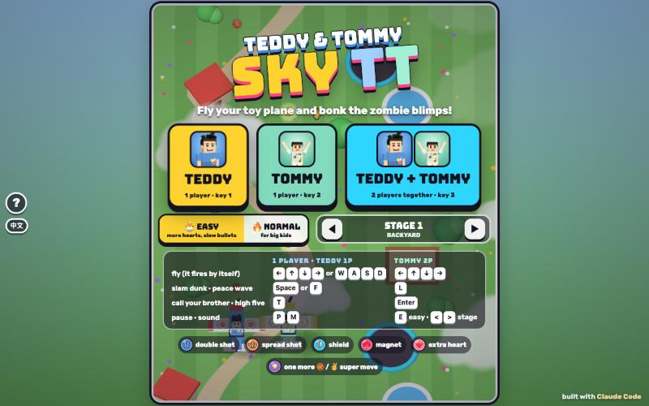

# Sky TT

[](https://adong.github.io/sky-tt/)

A classic plane shooter: fly a toy plane, bonk zombie blimps and bosses, and call your brother as a wingman. 10 stages, 1 or 2 players.

**中文：** 经典飞机射击：开着玩具飞机打僵尸飞艇和大 Boss，叫兄弟来当僚机。10 关，单人或双人。

Press **?** any time (or tap the round **?** button on the left edge) to see the keys. The game waits while you look.
Tap the language button under it (the A文 icon) to switch between English and 中文; the dashboard and every game remember the choice.

A classic vertical shoot-'em-up for Teddy and Tommy, the kind Dad played in the arcade, made for small hands and best played together. It's built with Claude Code from plain JavaScript and Three.js, on the shared Claude Games kit.
The brothers fly bright toy planes up the screen, each one sitting in his open cockpit and looking up at you. The plane fires by itself, so all you do is fly, dodge and catch things.
There are no image, model or audio files: the planes, enemies and places are built from boxes and balls, every texture is painted on a canvas, and every sound is synthesised.
It's silly, not war-like: Teddy fires 🏀 basketballs, Tommy fires ✌️ peace signs, and the zombie blimps, robot drones, UFOs and grumpy clouds go BONK! and pop into fruit, coins and stars.

The name lives in one constant, `SKY.TITLE` in `js/title.js`, and the page title, logo and ? panel all follow it.

## Play

- **Double-click `index.html`.** It works offline because Three.js and the kit are copied into `kit/`. Without internet the title font falls back to Arial Black.
- **Send one file:** `dist/sky-tt.html` is the whole game in one page (about 850 KB). AirDrop or email it, then open it in a browser.
- Rebuild that file after any edit: `python3 kit/tools/bundle.py . --name sky-tt`

On the title screen, tap your face to play alone (**TEDDY** or **TOMMY**), or tap **TEDDY + TOMMY** for two players on one keyboard or one iPad. Pick 🐣 **EASY** (the default) or 🔥 **NORMAL** and any of the 10 stages first, if you like.

## Controls

| | Teddy (1P) | Tommy (2P) | Touch |
|---|---|---|---|
| fly | W A S D | ← ↑ → ↓ | drag anywhere |
| fire | by itself | by itself | by itself |
| super move: 🏀 slam dunk · ✌️ peace wave | Space or F | L | the big 🏀 / ✌️ button |
| call your brother (1 player) · high five (2 players) | T | Enter | tap his face |
| pause · sound | P or Esc · M | | ❚❚ · 🔊 under the stage name |

- **Playing alone**, both key sets fly your plane, so the arrows, L and Enter work too.
- **Touch: drag anywhere** on the screen, even on the sides. The plane moves as far as your finger does (a little further on a small phone), so your finger never covers it. Lift your finger and put it down anywhere to carry on.
- **Two players on an iPad:** the left half of the screen flies Teddy and the right half flies Tommy, so each thumb drags its own plane. Each brother has his own super-move button at the bottom of his side, and the high-five button sits above Tommy's.
- **A mouse** works the same way: hold the button and drag.
- **Title screen keys:** 1 plays Teddy, 2 Tommy, 3 both, E toggles easy, ← → (or < >) pick the stage, and Enter plays again.

## How it works

- **The screen:** the planes fly near the bottom, and the ground scrolls by underneath with clouds drifting past. The camera looks down at a slight tilt, so the kids in their cockpits are leaned back to face you.
- **The brothers' planes:**
  - Teddy's plane is blue with red trim and 🏀 on the wings. Tommy's is mint with orange trim and ✌️ on the wings.
  - Each kid is the kit character from the waist up: Teddy with his black spiky hair and blue brick tee, Tommy in his mint UFO tee. They look up at you, lean when the plane banks, and do their moves in the cockpit.
- **The enemies:**
  - **robot drones:** little orange quadcopters with a face on top. Quick, 1 hit, 100 points. Some fly in snakes, swoops, lines and V shapes.
  - **UFOs:** purple saucers with Bolt the robot in the dome. 3 hits, 300 points. They fire a fan of 3 (2 on Easy).
  - **grumpy clouds:** cross faces, 5 hits, 200 points. They rain drops straight down (snowballs on the snowy stage).
  - **zombie blimps:** green, googly-eyed, with a cartoon zombie riding on top. Slow, 9 hits, 400 points. They puff out a ring of goo.
  - **balloons:** three balloons carrying a present with a power-up badge on it. Pop them (2 hits) and the power-up floats down.
  - Enemy bullets are bright, round and outlined in black, so they show on grass, sand, snow and space alike. Enemies don't shoot when they're down near you, and they fly off the screen if you don't bonk them.
- **Bonked enemies** pop with a BONK!, POP! or POW! into coins, fruit and stars. Fly into them to catch them.
- **Getting hit** is a cartoon BONK!: the plane spins, you lose one heart and one weapon level, and you blink for a moment (3 s on Easy, 2 s on Normal). Enemy bullets close to you turn into little stars, so you get a moment to breathe.
- **Hearts:** 5 on Easy (up to 8), 3 on Normal (up to 5). At 0 you're out.
- **Super moves**, one per brother, refilled by 🌟 power-ups:
  - **Teddy's 🏀 SLAM DUNK:** a basketball hoop appears over the enemies (or over the boss), Teddy does his jump shot, and a giant ball flies up into the hoop. SLAM! Every enemy on screen goes BONK!
  - **Tommy's ✌️ PEACE WAVE:** Tommy does his Y pose with peace fingers (比耶), and a rainbow ring of ✌️ rolls out from his plane across the whole screen, bonking every enemy it passes.
  - Both turn every enemy bullet into little stars that fly to you, and take a tenth off a boss's bar. You can't be hit while one is going off.
  - You start each stage with at least 3 (Easy) or 2 (Normal), and can hold up to 5.
- **10 stages**, each in a different place, each a minute or so of waves. Every few stages ends with a cartoon boss:
  1. **BACKYARD:** grass, a garden path, a trampoline and a paddling pool.
  2. **BIG CITY:** rooftops and busy roads.
  3. **SUNNY BEACH:** umbrellas, palm trees, sandcastles and boats. Boss: **BIG ZOM BLIMP**, a huge zombie blimp with a crowned zombie on top.
  4. **FARM FIELDS:** patchwork fields, a red barn, hay bales and cows.
  5. **CLOUD KINGDOM:** a sea of clouds, rainbows and a castle in the sky. Boss: **STORMY**, a very grumpy storm cloud whose rain always leaves a dry lane.
  6. **SNOWY MOUNTAINS:** snowy pines, snowmen, a frozen lake and ski tracks.
  7. **CANDY LAND:** lollipops, candy canes, cupcakes, gumdrops and a mint river.
  8. **NIGHT CITY:** lit windows and street lights. Boss: **BIG BOLT**, the kit's robot as one giant head with propeller ears.
  9. **THE MOON:** craters, rockets, moon-base domes and a TT flag.
  10. **OUTER SPACE:** planets, asteroids and satellites. Boss: **KING UFO**, a giant saucer with a crowned zombie in the dome.
- **Bosses** take turns through their moves (fans, rings, spirals, aimed bursts, rain, little drone helpers), with a short rest in between. Below half their bar they hurry up a little. A boss bar shows at the top, and a "⚠️ LOOK OUT!" banner comes first.
- **Stage clear:** the brothers do their signature moves in their cockpits (Teddy shadow-boxes and does his jump shot, Tommy does his Y) as confetti falls, then zoom off the top. A tally shows what each brother bonked and caught.
- **Between stages** you keep your hearts, super moves, weapon and score. **TRY AGAIN** after a game over restarts the same stage with full hearts: never back to stage 1.
- **Progress is saved** in the browser: the stage picker remembers where you got to, marks cleared stages with ⭐ (separately for Easy and Normal) and boss stages with 👑, and the best score shows under the stage name (localStorage `skyTT.settings` and `skyTT.best`).
- **Points:** drone 100, cloud 200, UFO 300, blimp 400, balloon 50, boss 5000; coin 50, fruit 100, star 150, little star 20, power-up 500.

## Power-ups

| | | |
|---|---|---|
| blue badge, two arrows | double shot | 2 balls side by side. Catch more for 3, then 4 and faster. |
| orange badge, three arrows | spread shot | a fan of 3. Catch more for 5, then faster. |
| 🛡️ | shield | a bubble for 14 s (Easy) or 10 s (Normal) |
| 🧲 | magnet | coins, fruit and stars fly to you for 20 s (Easy) or 15 s |
| ❤️ | extra heart | +1 heart (+1000 if you're full) |
| 🌟 | super | one more slam dunk or peace wave |

- Catching the other shot type keeps your level. A bonk takes one level away.
- Power-ups come from the balloons (three or four each stage, always a 🌟 before a boss), and now and then a plain enemy pops into one too (more often on Easy). Every boss leaves a ❤️.

## Call your brother (companion mode)

**Playing alone**, the other brother is your companion: Tommy for Teddy, and Teddy for Tommy (`Kit.roster.buddyFor`). Call him with T, or tap the big button with his face, as often as you like. There's no waiting: Tommy keeps protecting you as long as you keep calling him.

- **He flies in** from the bottom as your wingman, in a smaller plane (his roster `buddyScale`), with his name tag and a golden ring under him.
- **He says hi** with his signature move: Tommy does his Y pose, Teddy shadow-boxes (jab, straight). Then he tosses you a treat (🍦 💧 🧃 🍪 🍉 🍌) that arcs into your cockpit: **"🍦 ICE CREAM FROM TOMMY!"**
- **He flies beside you for about 12 s**, on whichever side has more room, firing his own 🏀 or ✌️. His bonks and everything he catches count for you.
- **He protects you:** while he's there, every hit on you is blocked, with **"TOMMY SAVED YOU!"** (or **"TEDDY SAVED YOU!"**), a SAVED! burst and his hello move.
- **His time bar:** the bar with his face shows the time left, and so does the ring around his button.
- **Call again** once his treat has landed and he says hi again, brings another treat and stays the whole 12 s again. Calling before the treat lands just keeps him there longer.
- **At the end** he does his goodbye move (Teddy's jump shot, Tommy's Y) and flies off the top.

## Two players (Teddy + Tommy)

- Both brothers fly at once, Teddy on WASD and Tommy on the arrows (or each on their own half of an iPad).
- **HIGH FIVE** (T, Enter or the button with both faces): both planes get a 5 s shield, both brothers do their moves, each plane fires a ring of shots all around, and a ✋ HIGH FIVE! pops between them. Then it rests for 20 s (12 s on Easy), and its ring refills as it does.
- **When a brother runs out of hearts**, the other keeps flying. "TOMMY NEEDS A HIGH FIVE!": a high five brings him straight back with a shield. If nobody does, he comes back by himself after 10 s (6 s on Easy). It's game over only when both are out at once.

## Modes

- 🐣 **EASY** (the default, for Tommy, 5):
  - 5 hearts (up to 8) and 3 super moves.
  - About 70% as many enemies, with three quarters of the hits, flying a little slower.
  - Enemy bullets fly at 60% speed, are drawn 1.5 times bigger, and come half as often.
  - Bosses have 60% of their bar and fire fewer, slower bullets.
  - Longer blinking after a bonk (3 s), longer shields and magnets, more power-ups, and a slightly smaller target on your plane.
- 🔥 **NORMAL** (for Teddy, 8): 3 hearts (up to 5) and 2 super moves, and the full waves.
- On both levels, enemies shoot a little more often and a little faster stage by stage.

## Make it yours

- **`js/stages.js`** has every stage as a list of waves, with the format explained at the top: `[gap, pattern, foe, count, side]`, and `[gap, 'carrier', power-up, x]` for a balloon. Patterns are snake, swoop, line, vee, hover, strafe, drift and dive. Run `node tools/check.js` after editing.
- **`js/sim.js`** holds the numbers at the top:
  - `LEVELS`: Easy and Normal (hearts, enemy count and hits, bullet speed and size, fire rate, boss bar, shield and magnet times, the high-five rest).
  - `FOES` and `BOSSES`: size, hits, speed, points and drops; each boss's list of moves.
  - The treats, the companion's visit length and the weapons.
- **`js/art.js`** paints the places (`paintGround`) and lists what stands on the ground in each (`THEMES`).

## How it's tested

The rules (`js/sim.js`) and the autopilot (`js/brain.js`) have no Three.js in them. The browser game and a headless check run the same code at a fixed 60 ticks a second.

```bash
node tools/check.js
```

```bash
node tools/check.js --soak --seeds=5 [--easy | --normal] [--1p | --2p] [--buddy] [--clumsy]
```

- **Stage check:** 10 stages; every wave uses a known pattern, enemy, count and power-up; every boss is known; each stage has 25 to 90 s of waves and at least one balloon.
- **Rules (18):** the 2-player revive and high five, the companion (hello, treat, blocks every hit, comes back at once when called again, never two at a time, the right brother comes), power-up levels, hearts, and that Easy really is gentler than Normal.
- **Sabotage** proves the checks can fail. Each of these must be caught:
  - stage data with an unknown pattern, enemy, power-up, count of 0, or boss;
  - a pilot who never moves must lose every heart (so bullets really hit);
  - planes that can't shoot must not clear a boss stage;
  - a boss with 50 times the hp must not be beaten in time;
  - an enemy that never leaves must be reported stuck, and the stage must not clear;
  - a still pilot who keeps calling his brother must take no hits, and a companion who forgets to guard must let hits through.
- **Soak:** the autopilot plays every stage and every boss, each from a fresh start with no power-ups (what TRY AGAIN gives you). A stage counts as finished only if it clears without losing every heart, and an enemy alive for more than 40 s counts as stuck.
  - The autopilot tries 17 moves every other tick, looks 0.6 s ahead along each, and takes the safest one that also lines up a shot. It uses its super move only when every move would be a hit.
  - `--clumsy` is a slower, wobblier pilot (it thinks every 0.2 s): not a pass/fail test, just a feel for how hard each level is.
- **Last run:**
  - Stage check OK, 18 of 18 rules, 7 of 7 sabotage cases caught.
  - Soak, 5 seeds each: 1 player as Teddy and as Tommy on Easy and Normal (200 runs) and 2 players on Easy and Normal (100 runs): every stage finished, nothing stuck. With the companion called every 14 s (3 seeds, 120 runs): all finished.
  - The clumsy pilot (200 runs) finished everything: no hits at all on Easy, and 15 hits in 100 runs on Normal, mostly at the bosses.
  - Boss fights for the autopilot last 10 to 18 s on Easy and 15 to 32 s on Normal.

**Console hooks** (`window.game`), for the browser:

```js
game.start({ players: ['teddy', 'tommy'], stage: 4, level: 'easy' })  // straight into a stage
game.step(2)            // advance 2 s and draw (the Browser pane throttles animation while hidden)
game.freeze(true)       // stop real-time ticking; game.keepAwake() stops the auto-pause when the tab hides
game.state()            // mode, players, the companion, enemies, bullets, the boss...
game.buddy()            // press the companion button (the high five with 2 players)
game.special(0)         // player 0's super move
game.give('spread', 0)  // give player 0 a power-up: double, spread, shield, magnet, heart, super
game.power('shield')    // drop a power-up on the screen
game.boss()             // skip the waves and bring the boss (boss stages only)
game.autopilot(true)    // let the computer fly
game.clear()            // finish the stage (celebration, then the tally)
game.peek(x, y, 2)      // close-up camera on a point; game.peek() to go back
game.check()            // stage check, rules and sabotage; game.soak({ level: 'easy' }) runs the soak in the browser
```

Add `?touch=1` to the address to see the touch controls on a computer.

## Files

```
index.html       page, HUD, menus, touch buttons (CSS inline)
js/title.js      the game's name (SKY.TITLE)
js/stages.js     the 10 stages as lists of waves
js/sim.js        the rules: planes, shots, enemies and their paths, bosses, power-ups, super moves, the companion, events
js/brain.js      the autopilot (title-screen demo, game.autopilot, the soak)
js/check.js      stage check, rules, soak and sabotage (browser console and Node)
js/sfx.js        the game's own synth sounds and the take-off jingle
js/art.js        canvas textures, the planes with the kids, enemies, bosses, the 10 places, effects
js/game.js       renderer, camera, the loop, events to effects, HUD, menus, keys and touch, test hooks
js/keys.js       the ? panel's keys (Kit.help)
js/zh.js         the 中文 words and rules (Kit.lang): page text, toasts, banners, the ? panel and the 3D word bursts
tools/check.js   runs js/check.js in Node (no npm)
kit/             copy of ~/claude-games/kit (python3 ../kit/tools/sync.py .); don't edit it here
dist/sky-tt.html the single-page build
```

## Kit candidates

These are written here first. They're worth moving into `~/claude-games/kit` if another game wants them:

- **A pilot who faces a tilted camera** (`addPilot` in `js/art.js`): a Kit person from the waist up, leaned back by exactly the camera's tilt, so from above he reads like a front view and his signature moves (Tommy's Y, Teddy's jump shot) show clearly. Good for any top-down game with someone in a cockpit, a boat or a cart.
- **A scrolling painted ground** (`makeWorld` in `js/art.js`): one tile painted on a canvas and scrolled by its texture offset, with box-built props riding along at the same speed, recycled at the top, and a cloud layer drifting past faster.
- **Drag-anywhere touch control** (`pointerdown` / `pointermove` in `js/game.js`): the plane moves by the finger's movement rather than to the finger, so the finger never hides it; with two players, each half of the screen drives one brother.
- **A dodging autopilot** (`js/brain.js`): try a handful of moves, look ahead along each, and pick the safest. It also drives the title-screen demo.
- From Tank TT, adapted: comic burst textures, the sprite effects pool and game-clock toasts.

## Name ideas

Alan names the games. A few TT puns: **LiTTle Pilots**, **FluTTer Flyers**, **BonkTT Blimps**, **JeTT Set Brothers**.

## Not verified

- **Sound:** every effect, the jingle and the music are wired up, but nobody listened in this build. The test browser has no audio check.
- **Real touch devices:** touch was tested in the Browser pane with simulated pointer events, at phone landscape (740 × 360), phone portrait (390 × 844) and iPad (1024 × 768) sizes with `?touch=1`. It wasn't tried on a real iPhone or iPad, so how the drag feels under a real thumb is unknown.
- **Real-time feel:** play was mostly driven with `game.step()`. A real-frames copy of the single page ran 1:1 with the clock and froze correctly under the ? panel, but nobody played a long session at the keys.
- **Difficulty for the real kids:** the autopilot sees every bullet coming, so the soak proves every stage *can* be finished, not that Tommy will find Easy easy or Teddy will find Normal fun. The numbers at the top of `js/sim.js` are there to tune after they try it.
